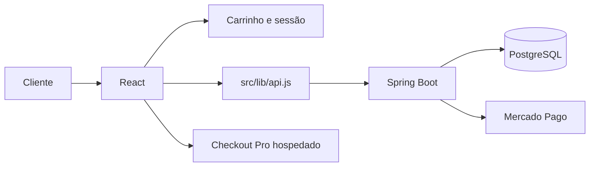

# Arquitetura do frontend

## Decisões

- **Checkout de convidado:** dispensa conta do comprador. O login é reservado à administração.
- **API centralizada:** apiFetch adiciona o token, interpreta ProblemDetail e limpa a sessão ao receber 401/403 com token.
- **Separação da administração:** rotas carregadas com lazy/Suspense reduzem o código administrativo no carregamento inicial da loja.
- **Persistência do carrinho:** CartContext usa armazenamento local para manter a seleção após recarregar.
- **Pagamentos fora da interface:** o formulário envia os dados do pedido; os dados de cartão são tratados no Checkout Pro.

## Contratos principais

| Operação | Endpoint |
| --- | --- |
| Catálogo | GET /api/produtos |
| Produto | GET /api/produtos/{id} |
| Checkout | POST /api/pedidos/checkout |
| Status para o comprador | GET /api/pedidos/{id}/status-publico |
| Pedidos administrativos | GET /api/pedidos |

O checkout usa o link em pagamento.linkPagamento; extrairLinkPagamento também reconhece variações de nomenclatura. Consulte o [contrato da API](https://github.com/AmomReis/GL-Multimarcas-Backend/blob/main/API.md).

## Limites

O controle de rotas no navegador melhora a experiência, mas a autorização efetiva pertence ao backend. Tokens ficam no localStorage; a prevenção de XSS e a expiração da sessão precisam ser consideradas na evolução do projeto. Disponibilidade da loja não comprova disponibilidade de pagamentos, banco ou notificações.
